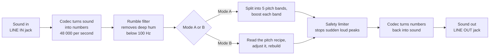
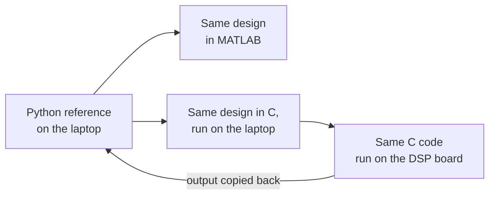
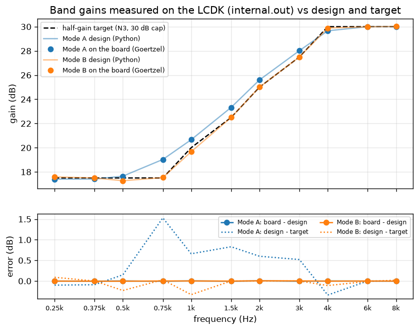
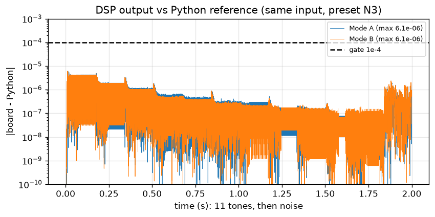
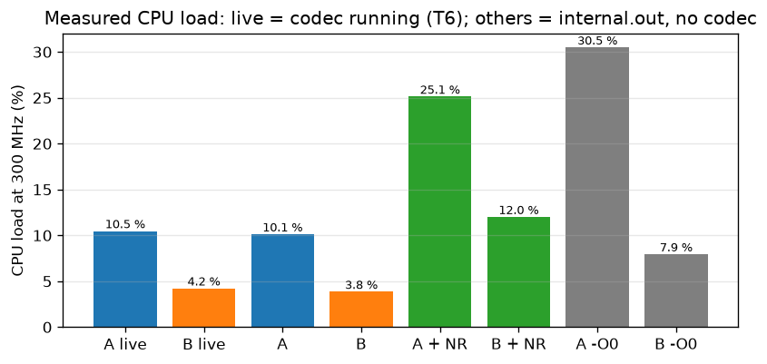
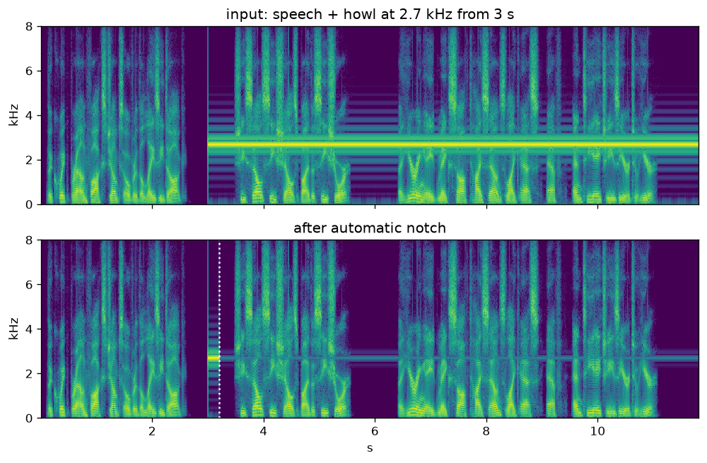
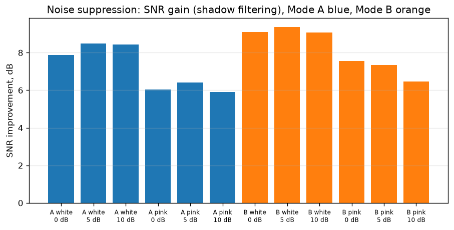

# Real-Time Digital Hearing Aid using Multirate Filter Bank and FFT-Based Overlap-Add Processing on TMS320C6748

**A project document for everyone: no engineering background needed**

DSP Lab project, Department of Electronics and Communication Engineering (ECE), National Institute of Technology (NIT) Warangal, Batch 1.

- Aneesh Venkatesha Rao (24ECB0A03)
- Akula Sahasra (24ECB0A02)
- Adhvay Shrujal (24ECB0A01)

Version 1.0. The code was frozen on 31 Oct 2026. This document is based only on what is in the project repository. The full technical report is [`report.md`](report.md).

**How to read this document.** The main text uses plain words. Boxes marked **"For the technically curious"** hold equations and design details. You can skip them and still follow the story. Every result is labelled with how we got it:

| Label | Meaning |
|---|---|
| **Measured on the board** | We ran it on the real hardware and read the number back. |
| **Simulated** | We computed it on a laptop with the same design. |
| **Calculated** | We worked it out with a formula. Nobody measured it. |
| **From the literature** | Taken from a published paper or data sheet. |

---

## 0. One-page summary

**What we built.** A hearing aid that runs on a small signal-processing circuit board made by Texas Instruments (TI). Sound goes in, the board makes some pitches louder than others to match a person's hearing loss, and the sound comes out again. It does this continuously, 48 000 times per second.

**Why it matters.** Most hearing loss is uneven. A person may hear low, deep sounds almost normally but miss high, sharp sounds such as "s", "f" and "t". Turning up the volume does not fix this: the low sounds become too loud before the high sounds become clear. A hearing aid must boost each pitch range by its own amount, and it must do so quickly, or the wearer hears an echo.

**How.** We built two different ways of doing the same job on the same board, so they can be compared fairly:

- **Mode A** splits the sound into 5 pitch bands, like sorting coins by size, and turns each band up by its own amount.
- **Mode B** looks at the sound's "recipe" of pitches in short chunks, adjusts the recipe, and rebuilds the sound.

**The five headline results**

| # | Result | How we know |
|---|---|---|
| 1 | The board computes exactly what we designed. Its output differs from our laptop reference by at most 0.00002 of full volume (2.0e-5), and its boost at each test pitch matches the design to within 0.01 dB (decibels, the unit of loudness; 0.01 dB is 300 times smaller than the 3 dB step researchers treat as "just noticeable"). | **Measured on the board** |
| 2 | The board has plenty of spare power. Mode A uses 10.5 % of the processor and Mode B uses 4.2 %, with sound running in and out. About 90 % of the processor is left free. | **Measured on the board** |
| 3 | The delay from sound in to sound out is 8.81 ms (thousandths of a second) in Mode A and 7.67 ms in Mode B. Both are under the 10 ms limit used in hearing-aid research. For scale, a blink takes about 100 ms, so the delay is less than a tenth of a blink. | **Calculated** (not measured, see §6.5) |
| 4 | For a typical moderate hearing loss, Mode A follows the prescribed boost to within 1.53 dB and Mode B to within 0.38 dB. For a steep loss, Mode A misses by 6.82 dB, so steep losses need Mode B (0.49 dB). | **Simulated**; the moderate-loss numbers are confirmed on the board |
| 5 | Two optional extras work on the board. Noise suppression made built-in speech 8.4 to 8.8 dB clearer against background hiss. The automatic whistle remover found and silenced a whistling tone within half a second, and never triggered on plain speech. | **Measured on the board** with built-in test sounds |

**Honest limits.** We never fed live sound from outside into the board (our laptop's audio output did not reach it reliably), so the delay was calculated, not measured. One high-pitched test tone (6 kHz, 6000 vibrations per second) could not be heard from the board's output, for a reason we did not find. The board's buttons respond, but once changed two settings at the same time. All of this is explained in §6.6.

---

## 1. The problem

### 1.1 What hearing loss is

Sound is a vibration of the air. How fast it vibrates sets the **pitch**. Fast vibrations sound high (a whistle, the letter "s"), slow ones sound low (a drum, a man's hum). Pitch is measured in **hertz (Hz)**, the number of vibrations per second. A **kilohertz (kHz)** is a thousand hertz. Hearing tests check pitches from 250 Hz to 8 kHz.

Loudness is measured in **decibels (dB)**. The decibel scale works in ratios, not amounts: every 10 dB is ten times more sound power. The hearing-aid researchers we followed use 3 dB as a "just noticeable" difference [S1, S2].

The kind of hearing loss a hearing aid treats (damage in the inner ear, called **sensorineural** loss) does not dull all pitches equally. In all three standard examples we used (§1.3), the loss gets worse as the pitch rises. Someone with such a loss may hear that a person is talking but not tell "fan" from "pan" from "tan", because the sounds that tell these words apart are high-pitched.

### 1.2 Why "just turn up the volume" does not work

Think of an old music system with one volume knob. If the treble is too quiet, turning the knob up makes the treble louder, but it also makes the bass boom. A better system has a **graphic equaliser**: a row of sliders, one per pitch range, as on a music app. You push up only the sliders you need.

A hearing aid is a graphic equaliser set to match one person's ears. For the person in our default example, the lowest pitches get about 17.5 dB of boost and the highest get 30 dB.

### 1.3 What an audiogram is

An **audiogram** is the chart a hearing test produces. At each test pitch (250 Hz, 500 Hz, 1 kHz and so on up to 6 or 8 kHz), it records the quietest sound the person can hear. This is written in **dB HL** ("hearing level"), where 0 dB HL is normal hearing and a bigger number means a worse loss.

We did not test real people. We used three **standard audiograms** published by Bisgaard and colleagues [S26], which hearing-aid researchers use as shared test cases:

| Audiogram | What it represents | Hearing loss, 250 Hz → 6 kHz (dB HL) |
|---|---|---|
| **N3** (our default) | moderate loss, gently sloping | 35, 35, 35, 35, 40, 45, 50, 55, 60, 65 |
| N2 | mild loss | 20 rising to 50 |
| S2 | mild but **steep** loss: fine at low pitches, very poor at high pitches | 20 rising to 95 |

The published tables stop at 6 kHz, so we did not make up an 8 kHz value.

**How much boost to give.** We used the oldest and simplest fitting rule, the **half-gain rule**: boost each pitch by half the hearing loss there [S27]. A 60 dB loss gets 30 dB of boost. We capped every boost at 30 dB. That cap is our own choice: a bigger boost makes whistling feedback and distortion more likely on a lab bench.

> **For the technically curious: the band gains.** Our five bands are split at 750 Hz, 1.5, 3 and 6 kHz. For each band we took the hearing level at a representative pitch (the geometric centre, interpolated on a log-frequency scale between table values), halved it and capped it at 30 dB. For N3 this gives B1 (< 750 Hz) 17.50 dB, B2 20.36 dB, B3 25.36 dB, B4 30.00 dB (30.36 before the cap), B5 (> 6 kHz) 30.00 dB. The half-gain rule is attributed to Lybarger (1944, 1963); we cite it through Venema [S27] and did not read the original. Working: `research/audiogram.md`.

---

## 2. The idea

We wanted a hearing aid that:

1. **boosts each pitch range by its own amount**, following the audiogram;
2. **works in real time**: every sound is processed as it arrives, with nothing stored up and played later;
3. **adds less than about 10 ms of delay**.

Why 10 ms? A hearing-aid wearer hears two copies of every sound: the processed one from the hearing aid, and the natural one that leaks past it into the ear. If the processed copy arrives too late, the two copies clash and the voice sounds hollow or echoey. Published hearing-aid research uses 10 ms as the upper limit [S1, S6]. One **millisecond (ms)** is a thousandth of a second.

To do this, the sound must become numbers. A **digital** hearing aid measures the air pressure many times a second, does arithmetic on the list of measurements, and turns the result back into sound. The arithmetic is called **digital signal processing (DSP)**. Doing the arithmetic on the numbers, instead of with analogue electronic circuits, means the same board can be reprogrammed for any audiogram.

---

## 3. How it works: the journey of a sound

**Stage 1: sound becomes numbers.** A chip called the **codec** (short for coder-decoder) measures the incoming electrical sound signal 48 000 times every second, writing each measurement as a 16-bit number (one of 65 536 possible levels). *Analogy:* a film camera takes 24 still photos a second, and the eye sees smooth motion. Here we take 48 000 "snapshots" of the sound per second, one about every 21 microseconds (millionths of a second). This conversion is done by the codec's **analogue-to-digital converter (ADC)**.

**Stage 2: remove rumble.** A **high-pass filter** lets everything above 100 Hz through and blocks lower sounds, such as hum from mains power, wind or handling noise. *Analogy:* a sieve that lets the useful grains through and holds back the large lumps. A **filter** in general is any process that lets some pitches through and holds others back.

**Stage 3: split and boost** (Mode A or Mode B, explained in §4). This is where the hearing-aid prescription is applied.

**Stage 4: safety limiter.** If the boosted sound would be too loud for the output to handle, the **limiter** holds it at a fixed ceiling, just below the maximum the system can represent. *Analogy:* a ceiling in a room; you can jump, but not through it. Without the limiter, a peak would be clipped harshly and sound distorted.

**Stage 5: numbers become sound.** The codec's **digital-to-analogue converter (DAC)** turns the numbers back into an electrical signal at the LINE OUT jack, ready for a speaker or headphones (with an amplifier).

> **For the technically curious: the data path.** The codec is a TI TLV320AIC3106 [S13], set up over an I2C (inter-integrated circuit) control bus at address 0x18. Samples travel over the McASP (multichannel audio serial port) [S14]. The McASP's Read FIFO (first-in-first-out buffer) collects 4 samples; the EDMA3 (enhanced direct memory access) engine copies them into memory without the processor's help; then one interrupt per 4-sample block (83.3 µs) wakes the processing code. The Write FIFO is off, because it would add 64 samples (1.33 ms) of delay and push Mode A over 10 ms. The high-pass filter is a 4th-order Butterworth at 100 Hz, designed by the bilinear transform with pre-warping and built as a cascade of 2 biquads in DF-II-T (direct form II transposed). Simulated response at 100 Hz: −3.01 dB. The limiter ceiling is −1 dBFS (decibels relative to full scale).

---

## 4. The two methods we built

Both modes apply the same prescription. They differ in **how** they separate the pitches.

### 4.1 Mode A: the filter bank ("sorting coins by size")

Imagine pouring a jar of mixed coins through a stack of sieves. The top sieve catches the largest coins; what falls through goes to a finer sieve, and so on. You end up with five piles, one per coin size. You can then multiply each pile by its own amount and pour everything back together.

Mode A does this with sound. A **filter bank** is a set of filters that splits sound into bands. Ours makes 5 bands:

| Band | Pitch range | Boost (N3 audiogram) |
|---|---|---|
| B1 | below 750 Hz | 17.50 dB |
| B2 | 750 Hz – 1.5 kHz | 20.36 dB |
| B3 | 1.5 – 3 kHz | 25.36 dB |
| B4 | 3 – 6 kHz | 30.00 dB |
| B5 | above 6 kHz | 30.00 dB |

Each step up the list is one **octave**: a doubling of pitch, the same step as from one "Sa" to the next "Sa" on a harmonium.

**The clever part: "multirate".** Low pitches change slowly, so they do not need 48 000 snapshots a second. After each split, the low part is described with half as many snapshots. This is called **decimation** (keeping every second number). The lowest band ends up at only 3 000 snapshots a second. Working with fewer numbers saves a lot of arithmetic: Mode A needs 61 operations per snapshot, against 313 for the same filters at full speed, so it is about 5 times cheaper (calculated). Before the bands are added back together, each one is brought back to full speed by **interpolation** (filling in the missing snapshots smoothly). A system that works at several snapshot rates is called **multirate**.

**The cost: delay.** Sorting low pitches finely takes time, because a slow vibration needs a longer stretch of sound before you can tell what it is. Mode A's sorting adds 375 snapshots of delay, which is 7.81 ms. More than half of that (4.17 ms) comes from the lowest split alone. This is why we stopped at 5 bands: a 6th band would roughly double the delay, to about 16–17 ms, which is over the 10 ms limit (calculated).

> **For the technically curious: Mode A in detail.** Each of 4 levels k = 0…3 runs at rate fs_k = 48/2^k kHz and splits its input with **G**, a 21-tap Kaiser-window low-pass (β = 4.5, cut-off fs_k/8), followed by decimation by 2. **F**, a 31-tap half-band filter (17 non-zero taps, centre tap 0.5), interpolates the lower levels' output back up by 2. The high band is the input minus the delayed low-pass path, so the bank is **complementary**: with all gains at 1 the output is exactly the input delayed by 375 samples (simulated ripple +0.020 / −0.010 dB). Filter lengths come from the Kaiser formula N ≈ (A − 7.95)/(14.36 Δf) + 1 [S21]: A = 50 dB, Δf = 0.15 gives 21 taps; Δf = 0.10 gives 31 (half-band filters need N = 4m − 1). Achieved stopbands: G 52.5 dB, F 51.1 dB. Decimation does not alias: G is already 52 dB down at 0.20 fs_k, and after ↓2 the band 0.30–0.50 fs_k folds onto 0–0.20 fs_k. Simulated alias rejection is −73.4 dB per level, image rejection −74.4 dB. Delay per level: T_k = 10 + 15 + 2·T_{k+1}, so T_0 = 25·(2⁴ − 1) = 375 samples. On the DSP each level keeps a power-of-two circular history (512/256/128/16 samples) indexed with a bit mask, and delay buffers of 365/165/65/15 samples keep the bands in step.

### 4.2 Mode B: the FFT method ("adjusting the recipe")

Any sound, however complex, is a mix of simple pure tones at different pitches and strengths, the way a dish is a mix of ingredients in different amounts. The list of pitches and their strengths is the sound's **spectrum**, its "recipe".

A mathematical tool called the **Fourier transform** reads off this recipe. The **discrete Fourier transform (DFT)** does it for a list of numbers. The **fast Fourier transform (FFT)** is a clever shortcut that gives exactly the same answer with far less arithmetic. On our board, a direct DFT of 256 numbers took 107 797 012 clock cycles; TI's FFT took 2145, about 50 000 times fewer (**measured on the board**).

Mode B works on chunks of 128 snapshots (about 2.7 ms of sound each):

1. Take a chunk and read its recipe with an FFT.
2. Multiply each ingredient by the boost the audiogram asks for at that pitch.
3. Rebuild the sound from the adjusted recipe with an **inverse FFT (IFFT)**.
4. Each rebuilt chunk is a little longer than the original and spills into the next one, so the spill-over is added onto the next chunk. This is called **overlap-add (OLA)**. *Analogy:* laying roof tiles, where each tile overlaps the next so there are no gaps.

Mode B describes the boost at 65 pitches spaced every 372 Hz, much finer than Mode A's 5 octave bands. That is why it follows the audiogram more closely.

> **For the technically curious: Mode B in detail.** The gain curve is turned into a 129-tap linear-phase FIR (finite impulse response) filter by **frequency sampling**: H(k) is set to the target gain at 65 frequencies k·fs/129. It follows the N3 target within 0.38 dB; a Kaiser-window design of the same length misses by 1.00 dB (simulated), which is why frequency sampling was chosen. Each block holds L = 128 new samples, zero-padded to N = 256 ≥ L + M − 1 = 128 + 129 − 1, so circular convolution equals linear convolution. OLA and overlap-save (OLS) both match direct convolution within 1e-14 (simulated). If N is too small the tails wrap around (time aliasing): errors of 0.29 / 9.5 / 18.9 at N = 224 / 192 / 160. On the DSP, the interrupt fills one 128-sample buffer while the background loop processes the previous one (double buffering), using TI's DSPLIB (DSP library) routines `DSPF_sp_fftSPxSP` and `DSPF_sp_ifftSPxSP`; our own radix-2 FFT is a build option. Delay model: 2L + (M − 1)/2 = 320 samples = 6.67 ms, plus I/O (input/output) buffering and the codec (calculated).

### 4.3 When each mode is better, and why we kept both

| | Mode A (filter bank) | Mode B (FFT recipe) |
|---|---|---|
| Follows a moderate loss (N3) | within 1.53 dB (simulated; board shows the same) | within 0.38 dB |
| Follows a steep loss (S2) | misses by 6.82 dB: **not suitable** | within 0.49 dB |
| Delay (calculated) | 8.81 ms | 7.67 ms |
| Processor use (measured on the board) | 10.5 % | 4.2 % |
| Works on | one snapshot at a time | chunks of 128 snapshots |
| Natural next step | automatic volume control per band (compression) | noise removal per pitch |

Mode B is more accurate, cheaper and a little faster. Mode A is still useful: it handles every snapshot the moment it arrives, and its separate bands are the natural place to add per-band loudness control (compression, which real hearing aids use). Mode A fails on the steep loss because 5 bands one octave wide cannot follow a jump of 15.7 dB between neighbouring bands; its boost changes too gradually.

Building both on the same board let us compare them on equal terms, and it covers more of the course syllabus (§8).

---

## 5. The hardware

### 5.1 The board

We used the **TI LCDK** (LCDK: low-cost development kit) with a **TMS320C6748** processor, made by Texas Instruments [S8, S11]. A development kit is a ready-made board for learning and testing a chip. It has jacks for LINE IN, LINE OUT and a microphone, buttons, small lights (LEDs, light-emitting diodes) and switches.

- The processor runs at **300 MHz**: 300 million clock "ticks" per second. We confirmed this on the board in two independent ways (**measured on the board**).
- At 48 000 snapshots per second, that leaves exactly **6250 ticks** per snapshot (**measured on the board**). All the work on one snapshot must fit into those ticks, every time.
- Button S2 switches between Mode A and Mode B. Button S3 steps through the audiograms N3, N2, S2 and "bypass" (no boost). (Naming note: the button S2, the steep audiogram S2 and the reference [S2] are three different things.) Two small switches turn the noise suppression and the automatic whistle remover on or off.

We controlled the board from a laptop through a debug cable, using TI's Code Composer Studio (CCS) software and scripts we wrote, so that every test could be repeated without clicking through menus.

### 5.2 What "real time" means here

Real time does not mean "fast". It means **never late**. A new snapshot arrives every 21 microseconds whether or not the processor is ready. If the processor ever falls behind, a snapshot is lost and the wearer hears a click. So the question is not "how fast on average" but "is there always spare time". On the board the answer was yes: the processor was busy 10.5 % of the time in Mode A and 4.2 % in Mode B, with no lost snapshots in 60-second runs (**measured on the board**).

### 5.3 Why a DSP chip and not a laptop

A **digital signal processor (DSP chip)** is a processor designed for exactly this kind of repeated multiply-and-add arithmetic.

- **It is built to multiply and add in parallel.** The C6748 can issue up to 8 instructions in one tick [S9]. TI's ready-made FFT on it took 2145 ticks for 256 points, against 228 676 ticks for our own simple, readable version (**measured on the board**).
- **Its timing is predictable.** On the board, our program is the only thing running, and every block of work takes a known number of ticks (measured, §6.3). A laptop's operating system can pause a program for other tasks, so laptop audio relies on large buffers, and for a hearing aid every extra millisecond of buffering is a millisecond of delay. (This is general reasoning; we did not measure a laptop.)

> **For the technically curious: the C674x core.** The C674x is a VLIW (very long instruction word) design with 8 functional units (2 × .L .S .M .D), 64 registers and hardware fixed- and floating-point arithmetic [S8, S9]. It has a Harvard memory layout: separate level-1 caches for program (L1P) and data (L1D) in front of a unified 256 KB level-2 (L2) memory, plus 128 MB of external DDR2 memory. Our program code is 22.1 KB, and total L2 use is 68.6 KB (measured from the linker map). Every cycle count in this document comes from the core's time-stamp counter (TSCL). The 300 MHz clock was read from the PLL (phase-locked loop) registers (24 MHz × 25 / 2) and checked against the laptop's timer (300.20 / 299.89 MHz, laptop timing ±0.1 %).

---

## 6. What we tested and what we found

### 6.1 How we checked everything

We did not trust any single step. Each version of the design had to match the one before it within a tolerance we wrote down **before** running the test:

1. **Python reference.** A program in Python is the "answer key" for every block. Eleven scripts check their own results automatically (12 of 12 checks pass, including the board-analysis self-test).
2. **MATLAB copy.** The same design rewritten in MATLAB reproduces the Python numbers.
3. **C on the laptop.** The C code that will run on the board is first compiled on the laptop and fed the same test signals as Python.
4. **C on the board.** The same C runs on the DSP. In a special mode with no sound hardware involved, the board processes a stored test signal, and we copy its output back to the laptop and compare it with Python number by number.

### 6.2 Test: does the board compute the right thing?

**What we did.** The board processed a built-in test signal (11 pure tones at the audiogram pitches, then noise) in both modes. We compared every output number with the Python answer key. The board also measured its own boost at each tone with a built-in tone meter.

**What we found (measured on the board).**

- The largest difference between the board and Python was 0.0000061 of full scale (6.1e-6) in both modes, and 0.000020 (2.0e-5) with noise suppression on. The pass mark was 0.0001 (1e-4).
- The board's boost at every test pitch matched the design to within 0.01 dB:

| Pitch | 250 | 375 | 500 | 750 | 1 k | 1.5 k | 2 k | 3 k | 4 k | 6 k | 8 k |
|---|---|---|---|---|---|---|---|---|---|---|---|
| Prescribed (half-gain, dB) | 17.5 | 17.5 | 17.5 | 17.5 | 20.0 | 22.5 | 25.0 | 27.5 | 30.0 | 30.0 | 30.0 |
| Mode A on the board (dB) | 17.40 | 17.41 | 17.65 | 19.03 | 20.66 | 23.33 | 25.60 | 28.02 | 29.66 | 30.00 | 30.00 |
| Mode B on the board (dB) | 17.59 | 17.50 | 17.27 | 17.53 | 19.67 | 22.50 | 25.00 | 27.50 | 29.89 | 29.99 | 30.02 |

**What it means.** The digital part of the hearing aid on the board does exactly what was designed. Mode B sits almost on the prescription. Mode A's biggest miss (1.53 dB, at 750 Hz) is at a boundary between two bands, where the design predicted it. Both stay within the 3 dB "just noticeable" limit for this audiogram.

*Figure 1. Top: the prescribed boost (dashed), the designed boost (lines) and what the board measured (dots). Bottom: the board's difference from the design is flat at zero; Mode A's design differs from the prescription by up to 1.53 dB at 750 Hz.*

*Figure 2. The board's output minus the Python answer key, number by number. The differences are tiny rounding effects.*

> **For the technically curious.** This is test T2 (band gains) and T3/T4 (response), run in `IO_INTERNAL` mode (`internal.out`). The tone meter is a Goertzel algorithm with N = 4608 samples (96 ms), chosen so all 11 test tones land exactly on analysis bins (see story X1 in §7). Accuracy against the target for the other audiograms is simulated only: N2 1.01 dB (A) / 0.22 dB (B); S2 6.82 dB (A, at 1.5 kHz) / 0.49 dB (B). The codec's analogue response is outside this test.

### 6.3 Test: is there enough processing time?

**What we did.** We ran each mode for 60 seconds with the codec running, and counted the processor ticks spent on each block of sound.

**What we found (measured on the board).**

| | Busy time, average | Busy time, worst block | Estimate before the board (calculated) |
|---|---|---|---|
| Mode A | 10.5 % | 11.1 % | 2.5–10.2 % |
| Mode B | 4.2 % | 4.3 % | 2.6–5.0 % |

No lost snapshots, no errors from the audio port, and no limiting in either run.

**What it means.** Both modes leave about 90 % of the processor free. Mode B is cheaper because TI's hand-tuned FFT routines do the heavy work twice per 128 snapshots, while Mode A runs four levels of filters on every single snapshot in plain C. Mode A came out slightly above its estimate (10.5 % against 10.2 %), so our assumed cost per operation was a little optimistic.

With the optional extras on (measured without the codec, processing only): noise suppression raises Mode A to 25.1 % and Mode B to 12.0 %. It still fits easily.

*Figure 3. Processor load per mode, live with the codec and in the processing-only test.*

> **For the technically curious.** Budget: 25 000 cycles per 4-sample block (83.3 µs at 300 MHz). Mode A: 2617 average / 2785 maximum cycles per block → 2617 / 25 000 = 10.5 %. Mode B: 829 / 851 cycles per block in the interrupt plus 7242 / 7253 cycles per 128-sample background block → (829 + 7242/32) / 25 000 = 4.2 %. The cost does not depend on the signal: there are no data-dependent branches apart from the limiter, which never acted. Processing only (no codec): Mode A 10.1 %, Mode B 3.8 %. The per-sample fallback I/O path (FIFO off) had a worst interrupt of 1875 of 6250 cycles.

### 6.4 Test: the optional extras

**Noise suppression.** This feature estimates the steady background hiss in each pitch range and turns that range down when it holds mostly hiss. *Analogy:* in a noisy room you learn to ignore the fan's steady hum and listen to the voice.

- **On the board** (2 s of built-in speech mixed with board-generated hiss, the speech carrying only about 3 times the power of the hiss, a 5 dB signal-to-noise ratio): Mode A improved the **signal-to-noise ratio (SNR)**, how much stronger the speech is than the noise, by 8.39 dB, and Mode B by 8.78 dB. The noise dropped by about 10.3 dB while the speech dropped by only 1.6 to 1.9 dB. The board's output equalled the Python answer key within 2e-5.
- **On the laptop** (two voices, two kinds of noise, three noise levels): +5.9 to +8.5 dB (Mode A) and +6.5 to +9.4 dB (Mode B) (simulated).

**Automatic whistle remover (feedback notch).** When a hearing aid's speaker is too close to its microphone, sound loops round and builds into a whistle, called **feedback** or **howl**. Our detector watches the sound's recipe for one pitch that stands out strongly and steadily. When it finds one, it places a **notch filter** there: a filter that removes one narrow pitch and leaves everything else. *Analogy:* cutting out one noisy instrument from an orchestra.

- **On the board** with built-in speech: 12 s of plain speech triggered no notch.
- Speech plus a steady 2500 Hz tone, 10 dB above the speech: a notch was placed within 0.5 s, at 2500.48 to 2500.83 Hz over repeated runs (error at most 0.03 %). Listening at LINE OUT, the user heard the whistle **stop** when the notch came on.
- A tone only as loud as the speech was left alone for 16 s. This is by design: the detector needs a peak 25 dB above its surroundings so that speech never triggers it. A real howl keeps growing until it dominates. The exact level between "as loud as speech" and "10 dB louder" at which detection starts was not measured.

*Figure 4 (simulated). A picture of sound over time (a spectrogram): time runs left to right, pitch runs upward, and brightness shows loudness. Top: speech with a howl at 2.7 kHz starting at 3 s (the bright horizontal line). Bottom: after the automatic notch, the line is gone a fraction of a second after it starts.*

*Figure 5 (simulated). How much clearer the speech became with noise suppression, for different voices and noise levels.*

> **For the technically curious.** Noise suppression gain per band (Mode A) or per frequency sample (Mode B): G = √max(1 − 2N/P, Gmin²), Gmin = −12 dB, where P is the smoothed power and N the noise floor from a simplified minimum-statistics estimate (the minimum of P over 4 × 0.375 s). In Mode B the 129-tap FIR is redesigned by frequency sampling every block, so overlap-add stays exact. Notch: 2nd-order IIR (infinite impulse response) filter from the bilinear transform of H(s) = (s² + ω0²)/(s² + (ω0/Q)s + ω0²), pre-warped at f0, Q = 10, designed on the DSP at run time; simulated depth 270 dB, −3 dB bandwidth 264 Hz (f0/Q = 270 Hz). Detector: Hann-windowed FFT-256 of each 128-sample block, 500 Hz–8 kHz; a peak ≥ 25 dB above the mean and stable within ±1 bin raises a leaky counter; the notch is placed at 75 counts; at most 2 notches. During the +10 dB run, before the notch acted, the limiter held the output (81 279 limited samples in the 16 s run, against 117–156 per phase from speech peaks alone). The papers we used only name these features as blocks and give no algorithm; the methods are standard ones whose primary sources we did not consult, so they are not cited.

### 6.5 What was calculated, not measured

**Delay.** Measuring the delay needs a live sound going in and a recording of what comes out. We did not use live input (§6.6, §7), so the delay is **calculated**:

| | Sorting / chunking | Moving data in and out (assumed) | Codec (from its data sheet) | Total |
|---|---|---|---|---|
| Mode A | 375 snapshots = 7.81 ms | 10 snapshots = 0.21 ms | 0.79 ms | **8.81 ms** |
| Mode B | 320 snapshots = 6.67 ms | 10 snapshots = 0.21 ms | 0.79 ms | **7.67 ms** |

Both are under 10 ms. For comparison, a published multirate hearing aid reported 32 ms with the same kind of symmetric filters and 11 bands, and 5.4 ms with a different filter type [S2].

**Other simulation-only results.**

- **Unwanted side tones at band boundaries:** the worst is −68 dBc, i.e. 68 dB quieter than the tone itself (pass mark −60 dBc) (simulated). **dBc** means "decibels relative to the main tone".
- **Limiter:** with speech at a normal test level and 30 dB of boost, only 0.04 % of snapshots reach the limiter in Mode A and 0.03 % in Mode B (simulated). On the board it never acted in the core tests.

### 6.6 Honest limitations

- **No live sound input.** Our laptop has no line input, and its output did not reliably reach the board's LINE IN: during one check, the board's input stayed at its background level (about −72 dBFS, i.e. 72 dB below the loudest value the numbers can hold) while the laptop played a tone. We therefore decided to test the board only with sounds stored inside it. As a result, the delay, the side tones at band boundaries and the limiter on the analogue path were not measured on the board.
- **The 6 kHz tone was not heard.** Listening to the board's output, the user heard the stored test tones except the 6 kHz one, although the board measures its boost at +30.00 dB with no clipping. The problem is after the DSP (codec, cable or speaker) or the listening level; we did not find which. A repeat test at a higher level was cut short when the board connection dropped, and no other speaker was available.
- **Buttons.** S2 and S3 change the LEDs, but in one session each press moved both the mode and the audiogram, and one press skipped an audiogram. We did not find out whether this was extra presses, switch bounce or interference between the two buttons. For demos, we set the mode and audiogram from the laptop instead.
- **No real-time listening.** There were no external speakers. To listen, we copied the board's output to the laptop and played it as a sound file. This is the board's exact output, but played afterwards, not live.
- **Steep hearing loss in Mode A** misses the prescription by 6.82 dB (simulated). Steep losses belong in Mode B.
- **Fixed boost only.** Real hearing aids also compress loud sounds (automatic volume control per band). This was optional and was not built.
- **Filter quality.** Our filters block unwanted pitches by about 52 dB. A hearing-aid filter standard (ANSI S1.11 class 2, from the American National Standards Institute) asks for more than 60 dB. Reaching it would take the delay to 10.79 ms, over our limit (calculated), so we chose lower delay.
- **Not run:** versions of the program without TI's library (built, not run on the board); a test of which input channel is used; the exact whistle-detection threshold; tests with our own voices (we used computer-generated voices).

---

## 7. Problems we hit and how we solved them

Most of these were caught by the pre-written pass marks, not by listening.

**X1. The tone meter that misread one tone.** Our first tone meter read the 375 Hz test tone 9.3 dB too quiet. The meter looked at 4800 snapshots, and 375 Hz does not fit a whole number of cycles into that window, so part of the tone "fell between the cracks". We changed the window to 4608 snapshots, which every test tone fits exactly, and the meter now refuses any tone that does not fit.

**X2. A filter structure that could not exist.** The design pack asked us to build one of the filters in a "lattice" structure. We showed this is mathematically impossible for that filter (some of its internal values must be exactly 1, which a lattice cannot hold) and demonstrated the lattice on the Mode B filter instead.

**X3. Rounding errors that grew.** The rumble filter passed the first check, but after the 30 dB boost its tiny rounding errors became large enough to fail the full-chain check. Keeping the filter's internal memory in higher precision fixed it (error fell from 2.8e-4 to 2.2e-5 against a 1e-4 pass mark).

**X4 and X5. Traps in the library documentation.** One TI routine's own test program shuffled the output in the wrong order (it only compared the routine with itself, never with a true answer), and another routine's description said it scaled its output when, in the version we used, it did not (it returned results 256 times too large). We checked both against our own reference before using them.

**X6. The whistle detector's teething troubles.** Our first detector could never reach its own threshold. A second voice, never used for tuning, caught a false trigger. A shared counter once placed a spurious second notch. The first noise tracker got stuck at zero. Each was fixed. One target was relaxed in the open: "detect within 0.3 s" became "within 0.5 s" (measured 0.20 and 0.41 s), because shortening the hold just to pass would make speech more likely to trigger it.

**X7. The clock that seemed fast.** The board's own clock estimate read 302.77 MHz instead of 300. Some snapshots lost during start-up stretched the first second. Measuring over the second second gave 300.001 MHz.

**X8. A double write at start-up.** Copied habit from the textbook code wrote the first output word by hand while the data-copying engine also wrote it, raising an error flag every time. Removing the hand-written word fixed it.

**X9. Audio that never started after a power cycle.** The worst bug. It worked in the first session, then failed every time after switching the board off and on. The textbook start-up code cleared all pending "data ready" signals, including the very first one, so the data-copying engine waited forever. One extra instruction to re-check pending signals fixed it: 3 of 3 starts worked. This could not have shown up in simulation.

**X10. A ghost from the previous program.** Loading a new program does not stop the old one's data-copying engine. It kept writing sound into the new program's memory, producing impossible readings (18 million "cycles" in one counter). Every program now stops the audio hardware first, and all board measurements were repeated afterwards.

**X11 and X12. Connection problems.** The laptop's audio did not reach LINE IN reliably, which led to the decision to test only with built-in sounds. Later, a listening test was aborted by a board connection error ("Target failed to write"), and with no spare speaker it was not repeated.

> **For the technically curious.** Entries in [`CHANGES.md`](CHANGES.md): X1 = C10, X2 = C12, X3 = C14, X4 = C15 (`cfftr4_dif`: base-4 digit reversal gives 4.8e-6 error, bit reversal gives 37), X5 = C16 (C674x `icfftr2_dif` round-trip gain 256), X6 = C25, X7 = C27, X8 = C28 (the transmit status register XSTAT read `0x180`: transmit DMA error XDMAERR + transmit error XERR), X9 = C29 (the book's `EnableInterrupts_EDMA()` writes 0xffff to the interrupt clear register ICR and discards the first EDMA completion; fix: write the interrupt evaluate register IEVAL after enabling interrupts), X10 = C30 (`io_quiesce()` disables EDMA events and stops McASP0 at start-up), X11 = C31, X12 = C34. The file has 37 numbered entries (C1–C37) in all.

---

## 8. Syllabus coverage

Depth levels, as defined in `research/03_syllabus_mapping.md`:
- **Core**: part of the working hearing aid (or an essential design step).
- **Comparison**: built only to compare against the core method.
- **Supporting**: used in design or testing, not in the live signal path.
- **Explained**: described, with a measurement where noted, but not built as a separate block.

"Board" means checked on the LCDK; "PC" means checked on the laptop.

| Unit | Syllabus topic | Where it appears in the project | Plain-language meaning | Depth |
|---|---|---|---|---|
| 1 | DFT and its properties | Mode B; direct DFT vs FFT on the board (`lab_dft`) | Reading a sound's pitch recipe | Core (board) |
| 1 | Inverse DFT | Mode B inverse FFT; start-up check that it scales correctly (gain 1.0) | Rebuilding sound from a recipe | Core (board) |
| 1 | Linear filtering using the DFT | Mode B FFT size 256 ≥ 128 + 129 − 1; demo of errors when too small | Using the recipe method without the chunk ends wrapping round | Core (PC) |
| 1 | Overlap-add | Mode B | Joining processed chunks by adding their overlaps | Core (board) |
| 1 | Overlap-save | Laptop comparison with overlap-add (both match within 1e-14) | The other way of joining chunks | Comparison (PC) |
| 2 | Radix-2 DIT FFT | Our own FFT; TI's `cfftr2_dit` timed on the board | A standard FFT shortcut (decimation in time) | Core (own code) / Comparison (board timing) |
| 2 | Radix-2 DIF FFT | Our own DIF FFT (PC); TI's `icfftr2_dif` on the board | The same shortcut organised the other way (decimation in frequency) | Comparison |
| 2 | Radix-4 FFT | TI's `cfftr4_dif` timed on the board (4903 cycles); operation counts | An FFT that works in groups of 4 | Comparison (timing) |
| 2 | Split-radix FFT | Operation counts only (456 vs 642 multiplies at 256 points) | A mix of radix-2 and radix-4 with fewer multiplies | Explained |
| 2 | Goertzel algorithm | The board's built-in tone meter | Measuring one pitch cheaply without a full FFT | Core (test tool, board) |
| 2 | Chirp-Z transform | Zoomed view of the 600–900 Hz region (PC) | A magnifying glass on part of the recipe | Supporting (PC) |
| 3 | Linear-phase FIR | Filters G and F; Mode B filter | Filters that delay all pitches equally, so bands stay in step | Core |
| 3 | Location of zeros | Zero plots of G; zeros block the lattice (X2) | Where a filter completely blocks a pitch | Core (design analysis) |
| 3 | FIR design by windowing | G and F (Kaiser window); rectangular / Hamming / Kaiser compared | Shaping a filter by trimming an ideal one smoothly | Core |
| 3 | FIR design by frequency sampling | Mode B filter (65 gain points) | Building a filter by stating the boost at chosen pitches | Core |
| 4 | Bilinear transform | Rumble filter and notch filter, both on the board | Converting a classic electronic filter design into a digital one | Core (board) |
| 4 | Impulse invariance | Laptop comparison; shown why it cannot make a high-pass | Another conversion method, which fails here | Comparison (PC) |
| 4 | Matched z-transform | Laptop comparison (agrees with bilinear to 0.000 dB above 50 Hz) | A third conversion method | Comparison (PC) |
| 5 | FIR direct form | G and F on the board | Building a filter as a plain chain of multiply-adds | Core (board) |
| 5 | FIR cascade form | Laptop comparison with 16-bit coefficients | A filter built as small filters in series | Comparison (PC) |
| 5 | FIR frequency-sampling structure | Mode B filter rebuilt as comb + 129 resonators (PC) | A filter built from many tuned resonators | Comparison (PC) |
| 5 | FIR lattice | Mode B filter in lattice form; impossible for G (X2) | A ladder-like filter structure | Comparison (PC) |
| 5 | IIR direct form I and II | Rumble filter in DF-I, DF-II, DF-II-T; DF-II-T chosen (least noise) | Different wiring of the same recursive filter | Core |
| 5 | IIR cascade | Rumble filter = 2 biquads on the board | A recursive filter split into 2nd-order pieces | Core (board) |
| 5 | IIR parallel | Laptop comparison (loses accuracy near 0 Hz) | Pieces side by side instead of in series | Comparison (PC) |
| 5 | IIR lattice and lattice-ladder | Laptop comparison (cut-off shifts to 130 Hz with 16-bit coefficients) | Ladder-like recursive structure | Comparison (PC) |
| 6 | Decimation | Mode A: 4 stages of halving the rate, on the board | Keeping fewer snapshots for slow sounds | Core (board) |
| 6 | Interpolation | Mode A: 4 stages of doubling the rate, on the board | Filling snapshots back in smoothly | Core (board) |
| 6 | Rational I/D conversion | Test speech converted 44.1 → 48 kHz (160/147) | Changing the snapshot rate by a fraction | Supporting (PC) |
| 7 | TMS320C6x architecture | Cycle counts and TI library use on the board | How the chip is built to do many things per tick | Core (explained + measured) |
| 7 | Harvard architecture | Separate program/data caches; memory placement in the linker file | Separate roads for instructions and data | Explained (+ placement) |
| 7 | Pipelining | −O0 vs −O3 compiler builds: 24× on a filter loop, 3.0–3.6× on whole modes (board) | Overlapping steps like an assembly line | Explained + measured |
| 7 | MAC hardware | TI FIR 838 vs plain C 1052 cycles (board) | Hardware that multiplies and adds in one step | Explained + measured |
| 7 | Fixed vs floating point | float32 vs Q15 on the laptop; int16 / int32 / float / double arithmetic timed on the board | Whole-number arithmetic vs arithmetic with a movable decimal point | Core (PC + board) |
| 7 | Addressing modes | Mode A circular buffers in C; hardware circular mode (AMR register) explained only | Reusing a fixed memory loop like a clock face | Core (C buffers) / Explained (hardware mode) |
| 7 | Memory architecture | Program in on-chip L2, large test buffers in DDR2 (68.6 KB L2 used) | Deciding which data sits in fast memory | Core |
| 7 | On-chip peripherals | McASP, EDMA3, I2C, GPIO (buttons, LEDs), time-stamp counter, all on the board | The chip's built-in helpers for audio, data copying and buttons | Core (board) |

> **For the technically curious: the numbers behind the table.** float32 vs Q15 SNR against float64 (simulated): HPF 85.0 vs 12.1 dB, Mode A 138.7 vs 42.7 dB, Mode B 139.5 vs 20.2 dB, so float32 was used. HPF structures with 16-bit coefficients (simulated): single 4th-order direct form unstable (pole radius 1.000000); cascade −3 dB at 100.8 Hz (0.16 dB error); parallel −2.3 dB at 20 Hz (loses the DC zeros); lattice-ladder −3 dB at 130 Hz. Biquad forms in float32: DF-II-T 85.0, DF-I 83.1, DF-II 74.6 dB SNR. G by method (21 taps): rectangular 24.2, Hamming 38.6, Kaiser 52.5 dB stopband. FFT complex multiplies at N = 256: radix-2 642, radix-4 492, split radix 456 (calculated). 256-term multiply-accumulate on the board: int16 316, int32 with 64-bit accumulator 522, float 326, double 1000 cycles. Chirp-Z zoom 600–900 Hz: 18.08 to 20.06 dB, matching `freqz`. FIR lattice on the minimum-phase Mode B filter: max |K| = 0.48.

### 8.1 Course lab experiments

| Lab topic | Where it is | Checked on |
|---|---|---|
| Arithmetic operations | `lab_arith`: int16 / int32 / float / double multiply-accumulate | board |
| DFT | `lab_dft`: direct DFT 107 797 012 cycles vs TI FFT 2145, both within 3.8e-6 | board |
| IDFT | direct inverse DFT (used by `lab_conv`); TI `ifftSPxSP`; start-up gain check = 1.0 | board |
| Overlap-save | Python `ols()` | PC only |
| Overlap-add | Mode B | board |
| Linear convolution | `lab_conv`: x = 1 2 3 4, h = 1 1 1 → 1 3 6 9 7 4 | board |
| Circular convolution | `lab_conv`: length 4 gives 8 7 6 9 (wrapped); length 6 via DFT equals linear | board |
| DIT FFT | own `fft_dit`; TI `cfftr2_dit` | board |
| DIF FFT | own `fft_dif` (PC); TI `icfftr2_dif` (board) | PC + board |
| Split-radix FFT | operation counts only | **explained only** |
| Mixed-radix FFT | TI `fftSPxSP` (the Mode B FFT); at 256 = 4⁴ points it uses radix-4 stages only, so a true mixed case was not exercised | board (timing, accuracy) |
| IFFT | own inverse FFT; TI `ifftSPxSP` | board |
| IIR filter design | rumble filter and notch by bilinear transform; impulse invariance and matched-z compared | board + PC |
| FIR filter design | window method (G, F) and frequency sampling (Mode B) | board + PC |
| Digital image processing | — | **not covered** (outside an audio project) |

---

## 9. What we would do next

None of this was done. It is listed so it is clearly separate from the results above.

1. **Measure the delay on the board** with a working line-level input and a recording of the output (test T5), together with the side tones at band boundaries (T9) and the limiter (T10).
2. **Find the 6 kHz problem**: repeat the listening test at a higher level with another speaker or headphones, to tell the codec, cable, speaker and listening level apart.
3. **Settle the button behaviour** by pressing S3 alone, slowly, while watching the mode on the laptop.
4. **Add compression** (automatic volume control per band, called WDRC: wide dynamic range compression), the feature real hearing aids rely on most. Mode A's bands are the natural place for it.
5. **Make Mode A cheaper** by processing it in blocks with TI's library filters (estimated at about 2 % of the processor, calculated).
6. **Measure the whistle-detection threshold** between "as loud as speech" and "10 dB louder".
7. **Run the no-library builds** on the board, and speed up our own FFT with a precomputed table of sine and cosine values.
8. **Stronger filters** (60 dB) if a way is found to keep the delay under 10 ms.
9. **Test with real voices**, our own recordings, instead of computer-generated speech.
10. Find and cite the **original papers** for the noise-suppression and whistle-detection methods.

---

## 10. Glossary

| Term | Plain meaning |
|---|---|
| ADC (analogue-to-digital converter) | The part that measures a sound signal and turns it into numbers. |
| Aliasing | A false low pitch that appears when a signal is sampled too slowly. |
| AMR (addressing mode register) | A setting on the C674x chip that makes memory addresses wrap round in hardware. |
| ANSI (American National Standards Institute) | A standards body; its S1.11 standard sets quality levels for audio band filters. |
| Audiogram | A chart of the quietest sound a person can hear at each pitch. |
| Band | A range of pitches, such as 1.5–3 kHz. |
| Bilinear transform | A method that converts a classic electronic filter design into a digital one without aliasing. |
| Biquad | A small 2nd-order recursive filter; bigger filters are built from several of them. |
| Butterworth filter | A classic filter shape that is as flat as possible in the pitches it passes. |
| Bypass | A setting in which the hearing aid applies no boost. |
| C (programming language) | The language our board program is written in. |
| C1–C37 | Numbered entries in our corrections log, `docs/CHANGES.md`. |
| CCS (Code Composer Studio) | TI's software for building programs and loading them onto the board. |
| Chirp-Z transform | A calculation that zooms in on part of a sound's spectrum at fine detail. |
| Codec (coder-decoder) | The chip that converts sound to numbers (ADC) and numbers back to sound (DAC). |
| Coefficient | One of the fixed numbers a filter multiplies by; together they set the filter's behaviour. |
| Compiler optimisation level (−O0 / −O3) | How hard the compiler works to speed up code; −O0 is none, −O3 is the most. |
| Complementary filter bank | A filter bank whose bands add back up to exactly the original sound. |
| Compression (WDRC, wide dynamic range compression) | Automatic volume control that boosts quiet sounds more than loud ones. |
| CPU (central processing unit) | The part of the chip that runs the program; "CPU load" is how busy it is. |
| Crossover | The pitch where one band ends and the next begins. |
| Cycle (clock tick) | One step of the processor's clock; at 300 MHz there are 300 million per second. |
| DAC (digital-to-analogue converter) | The part that turns numbers back into a sound signal. |
| dB (decibel) | A ratio scale for loudness; 20 dB is ten times the sound pressure. |
| dB HL (hearing level) | Hearing threshold relative to normal hearing; a bigger number means worse hearing. |
| dBc | Decibels relative to a main tone; −68 dBc means 68 dB quieter than the tone. |
| dBFS (decibels relative to full scale) | Level compared with the loudest value the numbers can hold; 0 dBFS is the maximum. |
| DDR2 | A type of large external memory chip on the board. |
| Decimation | Keeping only every second (or every n-th) snapshot to lower the rate. |
| DF-I, DF-II, DF-II-T (direct forms) | Three ways of wiring the same recursive filter; DF-II-T (transposed) had the least rounding noise. |
| DFT (discrete Fourier transform) | The calculation that reads off the pitch recipe of a list of numbers. |
| DIT / DIF (decimation in time / frequency) | Two ways of organising the FFT shortcut. |
| DSP (digital signal processing) | Doing arithmetic on sound (or other signals) that has been turned into numbers. |
| DSP chip (digital signal processor) | A processor designed for fast, repeated multiply-and-add arithmetic. |
| DSPLIB (DSP library) | TI's collection of hand-tuned routines (FFT, filters) for its DSP chips. |
| ECE | Electronics and Communication Engineering. |
| EDMA (enhanced direct memory access) | A helper that copies data between the audio port and memory without the processor. |
| FFT (fast Fourier transform) | A fast way to compute the DFT, giving the same answer with far less arithmetic. |
| FIFO (first-in, first-out buffer) | A small queue that holds data in arrival order. |
| Filter bank | A set of filters that splits sound into several bands. |
| Filter | A process that lets some pitches through and holds others back. |
| FIR (finite impulse response) filter | A filter that computes each output from a fixed number of recent inputs. |
| Float32 / floating point | Number format with a movable decimal point, good for a wide range of sizes. |
| Frequency sampling | Designing a filter by stating the boost wanted at a set of pitches. |
| Goertzel algorithm | A cheap way to measure the strength of one chosen pitch. |
| GPIO (general-purpose input/output) | Chip pins used for simple on/off signals such as buttons and LEDs. |
| Half-band filter | A filter for halving or doubling the rate in which every second coefficient is zero, saving work. |
| Half-gain rule | A simple fitting rule: boost each pitch by half the hearing loss there. |
| Hann window | A smooth bell-shaped weighting applied to a chunk of sound before an FFT, to reduce smearing. |
| Harvard architecture | A chip design with separate paths for instructions and data. |
| High-pass filter (HPF) | A filter that passes high pitches and blocks low ones. |
| Howl / feedback | A whistle caused by sound looping from a hearing aid's speaker back to its microphone. |
| Hz / kHz (hertz / kilohertz) | Vibrations per second / thousands of vibrations per second; the unit of pitch. |
| I/O (input/output) | Getting data into and out of the processor. |
| I2C (inter-integrated circuit) | A simple two-wire bus the processor uses to set up the codec. |
| IFFT / IDFT (inverse FFT / inverse DFT) | Rebuilding a sound from its pitch recipe. |
| IIR (infinite impulse response) filter | A filter that also feeds back its own past outputs; efficient but must be designed with care. |
| Impulse invariance | A filter conversion method that copies an analogue filter's response sample by sample. |
| Interpolation | Raising the rate by filling in new snapshots smoothly between existing ones. |
| Interrupt | A signal that makes the processor stop and handle something at once, such as new audio. |
| Kaiser window | A smooth trimming shape for filter design with an adjustable trade-off (β). |
| KB / MB (kilobyte / megabyte) | Units of memory size: about a thousand / a million bytes. |
| L1, L2 (level-1, level-2 memory) | Fast memory on the chip; L1 is smallest and fastest. |
| Latency (delay) | The time from sound in to sound out. |
| Lattice | A ladder-like way of building a filter. |
| LCDK (low-cost development kit) | TI's ready-made board carrying the C6748 chip. |
| LED (light-emitting diode) | A small indicator light. |
| Limiter | A safety stage that stops the output from exceeding a ceiling. |
| LINE IN / LINE OUT | The board's audio input and output jacks for line-level signals. |
| Linear phase | A filter property: all pitches are delayed by the same time, so their timing is kept. |
| LSB (least significant bit) | The smallest step a number format can represent. |
| MAC (multiply-accumulate) | Multiplying two numbers and adding the result to a running total, the core step of filtering. |
| Matched z-transform | A filter conversion method that maps each analogue pole and zero directly. |
| MATLAB | A commercial program for numerical calculation, used here to repeat the Python design. |
| McASP (multichannel audio serial port) | The chip's port that exchanges audio samples with the codec. |
| MHz (megahertz) | Million cycles per second. |
| Minimum statistics | Estimating background noise as the lowest level seen over a recent stretch of time. |
| ms / µs (millisecond / microsecond) | A thousandth / a millionth of a second. |
| Multirate | Processing different parts of a signal at different snapshot rates. |
| N2, N3, S2 (standard audiograms) | Published example hearing losses: mild (N2), moderate (N3) and mild but steep (S2). |
| NIT | National Institute of Technology. |
| Noise suppression (NR, noise reduction) | Turning down pitch ranges that contain mostly steady background noise. |
| Notch filter | A filter that removes one narrow pitch and keeps the rest. |
| Octave | A doubling of pitch. |
| OLA / OLS (overlap-add / overlap-save) | Two ways of joining processed chunks so the result is seamless. |
| PC | Here, the team's laptop. |
| Pipelining | Overlapping the steps of successive operations, like an assembly line. |
| PLL (phase-locked loop) | The circuit that multiplies the board's crystal frequency up to the 300 MHz processor clock. |
| Pole / zero (of a filter) | A zero is a pitch the filter blocks completely; a pole is a resonance the filter builds on. |
| Python | A free programming language, used here for the reference design and all analysis. |
| Q (quality factor) | How narrow a notch is; Q = 10 means the notch width is a tenth of its pitch. |
| Q15 | A 16-bit whole-number format for fractions, used on chips without floating point. |
| Radix-2 / radix-4 / split radix / mixed radix | FFT variants that break the work into groups of 2, of 4, a mix of both, or of varying sizes. |
| Real time | Processing every sample before the next one is due, with no backlog. |
| Register | A small named memory cell inside a chip that holds a setting or status, e.g. XSTAT (transmit status), ICR (interrupt clear), IEVAL (interrupt evaluate). |
| Resonator | A tiny filter that rings at one pitch; many of them can form a frequency-sampling filter. |
| RMS (root mean square) | A way of stating the average level of a changing signal. |
| Sample (snapshot) | One measurement of the sound signal; we take 48 000 per second. |
| Sensorineural hearing loss | Hearing loss caused by damage in the inner ear or hearing nerve. |
| SNR (signal-to-noise ratio) | How much stronger the wanted sound is than the noise, in dB. |
| Spectrogram | A picture of sound: time left to right, pitch upward, brightness for loudness. |
| Spectrum | The pitch "recipe" of a sound: which pitches it contains and how strongly. |
| Spur (side tone) | An unwanted extra tone created by the processing. |
| Stopband | The pitch range a filter is meant to block; its attenuation says how well. |
| T1–T15 (test numbers) | Numbered tests in our test plan, `research/07_testing_plan.md`; e.g. T2 band gains, T5 latency, T6 CPU load. |
| Tap | One coefficient of an FIR filter; a 21-tap filter uses the 21 most recent samples. |
| TI (Texas Instruments) | The company that makes the C6748 chip and the LCDK board. |
| Time aliasing | Errors that appear when an FFT is too short and a filtered chunk's end wraps round to its start. |
| TLV320AIC3106 | Part number of the codec chip on the board. |
| TMS320C6748 (C6748, C674x) | Part number of TI's DSP chip; C674x is the name of its processor core family. |
| TSCL (time-stamp counter, low word) | A counter on the chip that counts clock cycles, used for all timing. |
| VLIW (very long instruction word) | A chip design that issues several instructions together in one cycle. |

---

## 11. References

Only sources used in this document are listed. Full details and check status are in `research/02_sources.md`.

- [S1] A. Sokolova, D. Sengupta, K.-L. Chen, R. Gupta, B. Aksanli, F. Harris, H. Garudadri, "Multirate Audiometric Filter Bank for Hearing Aid Devices," *55th Asilomar Conf. on Signals, Systems, and Computers*, 2021, pp. 1436–1442.
- [S2] A. Sokolova, D. Sengupta, M. Hunt, R. Gupta, B. Aksanli, F. Harris, H. Garudadri, "Real-Time Multirate Multiband Amplification for Hearing Aids," *IEEE Access*, vol. 10, pp. 54301–54312, 2022.
- [S6] H. Kayser, T. Herzke, P. Maanen, M. Zimmermann, G. Grimm, V. Hohmann, "Open community platform for hearing aid algorithm research: open Master Hearing Aid (openMHA)," *SoftwareX*, 17, 100953, 2022.
- [S8] Texas Instruments, *TMS320C6748 Fixed- and Floating-Point DSP* (data sheet), SPRS590G.
- [S9] Texas Instruments, *TMS320C674x DSP CPU and Instruction Set Reference Guide*, SPRUFE8B.
- [S11] Texas Instruments, *OMAP-L138/C6748 Development Kit (LCDK) User's Guide*, SPRUIL2A.
- [S13] Texas Instruments, *TLV320AIC3106 Low-Power Stereo Audio CODEC*, SLAS509G.
- [S14] Texas Instruments, *TMS320C674x/OMAP-L1x McASP User's Guide*, SPRUFM1.
- [S21] J. G. Proakis, D. G. Manolakis, *Digital Signal Processing: Principles, Algorithms, and Applications*, 4th ed., Pearson, 2007.
- [S26] N. Bisgaard, M. S. M. G. Vlaming, M. Dahlquist, "Standard Audiograms for the IEC 60118-15 Measurement Procedure," *Trends in Amplification*, 14(2):113–120, 2010.
- [S27] T. Venema, "The NAL-NL1 Fitting Method," *AudiologyOnline*, 2001 (cited for the half-gain rule of Lybarger 1944/1963; original not read).

The board-support code from Welch, Wright and Morrow's textbook [S19] and TI's C674x DSPLIB 3.4.0.0 [S28] were used to build the software; they are not redistributed in this repository.
