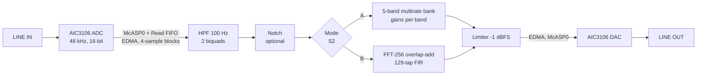

# Real-Time Digital Hearing Aid using Multirate Filter Bank and FFT-Based Overlap-Add Processing on TMS320C6748

DSP Lab project, Department of ECE, NIT Warangal (Batch 1)

- Aneesh Venkatesha Rao (24ECB0A03)
- Akula Sahasra (24ECB0A02)
- Adhvay Shrujal (24ECB0A01)

> **Status of this report (15 Oct 2026).** Every number below is either **measured** (on the LCDK or in a script in this repository) or **calculated** (labelled). **Test decision (CHANGES C31):** the project uses no external audio input. The board is verified with built-in signals: the stored tone set, a built-in speech clip, and on-board noise and tones. Codec-path latency (T5), crossover spurs (T9) and the limiter (T10) are therefore reported from simulation only (§8.4).

## Abstract

Hearing loss changes with frequency, so a hearing aid must amplify each frequency band by a different amount, with a delay short enough not to disturb the wearer (under 10 ms). We built a real-time digital hearing aid on the TI TMS320C6748 LCDK at 48 kHz, with two selectable processing modes:

- **Mode A:** a five-band multirate filter bank. Four levels of a 21-tap Kaiser low-pass, decimation by 2 and a 31-tap half-band interpolator give crossovers at 750 Hz, 1.5, 3 and 6 kHz.
- **Mode B:** the same gain curve as a 129-tap frequency-sampling FIR, applied by FFT-256 overlap-add.

A 100 Hz Butterworth high-pass (bilinear transform) removes DC and rumble. Each band gets half-gain-rule gain for the Bisgaard N3 standard audiogram, capped at 30 dB. A bilinear notch with automatic howl detection and a noise suppressor were added as options.

The design was verified in Python, MATLAB and portable C (C matches Python within 2.2e-5). On the board, the DSP's own output matches the Python reference within 2.0e-5, and its on-chip tone meter reads every band gain within 0.01 dB of the design. Measured CPU load at 300 MHz with the codec running is 10.5 % (Mode A) and 4.2 % (Mode B). On the board, noise suppression raised the SNR of built-in speech by 8.4–8.8 dB, and the auto notch removed a 2.5 kHz tone within 0.5 s.

---

## 1. Introduction

A sensorineural hearing loss is measured as an audiogram: the hearing threshold in dB HL at 250 Hz to 8 kHz. A hearing aid compensates by applying more gain where the loss is larger. Two requirements make this a DSP problem:

1. **Frequency-dependent gain** that follows the audiogram closely.
2. **Low delay.** Sokolova et al. [S1] and openMHA [S6] use 10 ms as the limit, because the wearer also hears the direct sound and longer delays cause comb filtering and an echo.

Published real-time designs use multirate filter banks [S1, S2, S3] or FFT processing [S6]. We built both on one board so they can be compared directly on the same hardware: the filter bank (Mode A) and FFT overlap-add (Mode B).

**Objectives**
- Design both modes for the Bisgaard N3 audiogram with the half-gain rule.
- Keep the end-to-end latency under 10 ms.
- Verify every block against a reference before it runs on the DSP.
- Measure gains, latency and CPU cycles on the board.
- Cover the DSP syllabus with working code: DFT/FFT, FIR, IIR, structures, multirate, and DSP processors (§9).

## 2. System overview



| Item | Value |
|---|---|
| Board | TI LCDK C6748: C674x DSP, 300 MHz (TI GEL), 256 KB L2, 128 MB DDR2 |
| Codec | TLV320AIC3106, I2C address 0x18, codec is clock master, DSP mode, 48 kHz |
| I/O | McASP0 with the Read FIFO on (4 words) and the Write FIFO off; EDMA3 moves 4-sample blocks; one interrupt per block (83.3 µs) |
| Fallback I/O | Per-sample McASP interrupt with the FIFO off (book code [S19]) |
| Controls | S2 = mode A/B (LED D4), S3 = audiogram preset N3 / N2 / S2 / bypass (D5 blinks); DIP SW1-5 = noise suppression, SW1-6 = auto notch; D6 = CPU-busy pin for a scope |
| I/O modes | `IO_LIVE` (codec in/out), `IO_STORED_LINEOUT` (stored signal to LINE OUT), `IO_INTERNAL` (no codec; outputs dumped for comparison) |
| Tools | CCS 7, TI CGT 8.1.3 (ELF), C674x DSPLIB 3.4.0.0, Python 3.12 + NumPy/SciPy, MATLAB (Signal Processing Toolbox), GCC 16 for PC tests |

## 3. Design

### 3.1 Sampling rate and input high-pass filter

- **48 kHz.** The octave crossovers fs/8, fs/16 … land exactly on 6 k, 3 k, 1.5 k and 750 Hz, and the codec and the book code support it.
- **HPF.** A 4th-order Butterworth at 100 Hz, designed by the **bilinear transform** with pre-warping and split into **2 biquads**. Measured −3.01 dB at 100 Hz (`python/p1_iir.py`, and MATLAB too).
  - Impulse invariance cannot be used for a high-pass: the analogue numerator and denominator have the same degree, so the impulse response contains a delta. `p1_iir.py` shows impulse invariance on a low-pass instead, together with its aliasing.
  - The matched-z design agrees with the bilinear design to 0.000 dB above 50 Hz.
- **Structure:** cascade of DF-II-transposed biquads. Coefficients and samples are float32; the state is kept in double precision (§5.2, C14).

### 3.2 Mode A: five-band multirate filter bank

Each level k (rate 48/2^k kHz) splits its input into a high band and a low band:

- **G** (21 taps, Kaiser β = 4.5, cut-off fs_k/8) low-passes, then the signal is **decimated by 2** for the next level.
- **F** (31-tap half-band, 17 non-zero taps, centre tap 0.5) interpolates the lower levels' output **back up by 2**.
- The high band is the input minus the delayed low-pass path, so the bank is **complementary**: with all gains at 1 the output is exactly the input delayed by 375 samples.

| Band | Range | Processed at | Gain (N3, half-gain, capped) |
|---|---|---|---|
| B5 | > 6 kHz | 48 kHz | 30.00 dB |
| B4 | 3–6 kHz | 24 kHz | 30.00 dB |
| B3 | 1.5–3 kHz | 12 kHz | 25.36 dB |
| B2 | 750 Hz–1.5 kHz | 6 kHz | 20.36 dB |
| B1 | < 750 Hz | 3 kHz | 17.50 dB |

- **Filter lengths** come from the Kaiser formula N ≈ (A − 7.95)/(14.36 Δf) + 1 [S21]. G needs 21 taps (A = 50 dB, Δf = 0.15) and F needs 31 (Δf = 0.10; half-band filters need N = 4m − 1). Achieved stopbands: G **52.5 dB**, F **51.1 dB**.
- **No aliasing:** G is already 52 dB down from 0.20 fs_k, and after ↓2 the band [0.30, 0.50] fs_k folds onto [0, 0.20] fs_k. Measured alias rejection is −73.4 dB per level, and image rejection with F is −74.4 dB (`p1_multirate.py`, and MATLAB).
- **Delay:** T_k = 10 + 15 + 2·T_{k+1}, so T_0 = 25·(2⁴ − 1) = **375 samples = 7.81 ms**. The simulated impulse peaks at sample 375. The lowest level costs the most delay (4.17 ms), because frequency resolution at low frequencies costs time.
- **Cost:** 61 operations per input sample, against 313 for a single-rate bank with the same transition widths: **5.1× cheaper** (calculated).
- **On the DSP:**
  - Mode A runs **per sample**, so it adds no block delay.
  - Each level keeps a power-of-two circular history (512/256/128/16), indexed with a mask. That is circular addressing in C.
  - Delay-alignment buffers keep the bands in phase: 365/165/65/15 samples.

### 3.3 Mode B: FFT overlap-add

- **FIR design by frequency sampling.** H(k) is set to the target gain at 65 frequencies k·fs/129 (spacing 372 Hz), giving a linear-phase FIR with M = 129 taps.
  - It follows the N3 target within **0.38 dB**.
  - A Kaiser-window design of the same length misses by **1.00 dB** (`p1_fir.py`), which is why frequency sampling was used.
- **Overlap-add.** Each block holds L = 128 new samples. It is zero-padded to N = 256 ≥ L + M − 1 = 256, transformed with an FFT, multiplied by H[k], transformed back, and the overlapping tails are added.
  - OLA and OLS both match direct convolution within 1e-14.
  - Undersizing N produces time aliasing: errors of 0.29 / 9.5 / 18.9 at N = 224 / 192 / 160 (`p1_ola.py`).
- **Real time.** The interrupt fills a 128-sample buffer while the background loop runs the FFT on the previous one (double buffering). The FFTs are DSPLIB `DSPF_sp_fftSPxSP` / `DSPF_sp_ifftSPxSP`, with our own radix-2 FFT as a build option.
- **Delay model:** 2L + (M − 1)/2 = 320 samples = 6.67 ms, plus FIFO and codec (calculated, **to be measured in T5**).

### 3.4 Gains, presets and limiter

- **Presets.** Half-gain rule on Bisgaard N3 (moderate) [S26], with a 30 dB cap. Button S3 also selects N2 (mild), Bisgaard S2 (steep) and bypass.
  - The half-gain rule is from Lybarger, cited via Venema [S27]. We did not read the original.
- **Accuracy (calculated):**
  - N3: Mode A max error 1.53 dB, Mode B 0.38 dB.
  - S2 (steep): Mode A 6.82 dB, Mode B 0.49 dB. Five octave bands cannot follow a 15.7 dB step between neighbouring bands, so **steep losses belong in Mode B**.
- **Limiter.** Output is held at −1 dBFS. With speech at −40 dBFS RMS (about 20 dB crest factor) and 30 dB gain, 0.04 % of samples reach it (`p1_chain.py`, C11).

### 3.5 Optional extras (from the project brief, off by default)

| Extra | Method | Result (PC) |
|---|---|---|
| Feedback notch | 2nd-order IIR from the **bilinear transform** of H(s) = (s² + ω0²)/(s² + (ω0/Q)s + ω0²), pre-warped at f0, Q = 10, designed on the DSP at run time | Depth 270 dB (zeros on the unit circle); −3 dB bandwidth 264 Hz vs f0/Q = 270 Hz |
| Howl detector | Hann-windowed FFT-256 of every 128-sample block, 500 Hz–8 kHz. A peak ≥ 25 dB above the mean and stable within ±1 bin raises a leaky counter; the notch is placed at 75 counts; at most 2 notches | 2.7 kHz howl removed after 0.20 s (49 dB down); 1.9 kHz after 0.41 s; **no false notch on either speech voice** |
| Noise suppression | Per band (A) or per frequency sample (B): G = √max(1 − 2N/P, Gmin²), Gmin = −12 dB; noise floor N by minimum statistics; Mode B redesigns the 129-tap FIR every block so overlap-add stays exact | SNR +5.9 to +8.5 dB (A), +6.5 to +9.4 dB (B) on two voices with white/pink noise at 0–10 dB SNR; speech level −0.9 to −4.1 dB |

**Sources:** the papers we used [S1–S3] only mention noise reduction and feedback cancellation as blocks; none gives an algorithm. The methods here are standard textbook ones (Wiener-type gain, minimum statistics, notch-based howl suppression). Their original references are **still to be checked** before this report cites them.

## 4. Method: how everything was verified

1. **Python reference** (`python/dsp_ref.py`) is the single source of truth for every block. Ten scripts check their own results with `assert` (`python/run_all.py`, 10/10 pass).
2. **MATLAB mirrors** (`matlab/*.m`) were run on 8 Oct 2026. They reproduce the Python numbers; small differences are listed in CHANGES C26. Log: `results/phase1_matlab/run_log.txt`.
3. **Portable C** (`c/`) is compiled with GCC on the PC and fed the same test vectors as Python (`c/build_pc.bat`). It is checked with two FFT back ends, our own and TI's.
4. **Board:**
   - The same C runs on the LCDK, driven headless from the command line with CCS Debug Server Scripting (`tools/dss_run.js`): load, run, read variables, dump memory.
   - `IO_INTERNAL` mode processes a stored test signal with no codec. Its output is dumped and compared sample by sample with Python (`python/board_compare.py`).
5. **Pre-declared gates:**
   - single blocks within 1e-5 of full scale;
   - modes and chains within 1e-4;
   - tone gains within 0.05 dB of `results/phase3/board_expected.txt`;
   - real-time margin as in `docs/board_checklist.md`.

## 5. Results: simulation and C

### 5.1 Filters, FFT and multirate (Python, confirmed in MATLAB)

| Check | Result |
|---|---|
| G stopband by method (21 taps) | rectangular 24.2 dB, Hamming 38.6 dB, **Kaiser β 4.5: 52.5 dB**, frequency sampling 19.6 dB (41.0 dB with one transition sample) |
| HPF at 100 Hz | −3.010 dB |
| Alias / image rejection per level | −73.4 / −74.4 dB |
| 44.1 → 48 kHz resampling (I/D = 160/147) | length and amplitude correct (48000 samples, 0.500) |
| OLA, OLS vs direct convolution | 1.1e-14, 1.2e-14 |
| Own radix-2 DIT / DIF FFT vs reference, N = 8 … 1024 | ≤ 7.6e-14 |
| Complex multiplies at N = 256 | radix-2: 642, radix-4: 492, split radix: 456 |
| Goertzel meter, 11 tones | all 0.100000 (amplitude 0.1), after fixing N = 4800 → 4608 (C10) |
| Chirp-Z zoom, 600–900 Hz | 18.08 to 20.06 dB (matches `freqz`) |
| Mode A delay | 375 samples |
| Reconstruction, all gains 1 | ripple +0.020 / −0.010 dB |

Figures: `results/phase1/` (Python) and `results/phase1_matlab/` (MATLAB), for example `p1_fir_G_methods.png`, `p1_chain_tone_gains.png`, `p1_ola_vs_direct.png`.

### 5.2 Structures and number format (Phase 2)

| Question | Measured | Choice |
|---|---|---|
| float32 or Q15? | SNR against float64 on speech: HPF 85.0 vs 12.1 dB; Mode A 138.7 vs 42.7 dB; Mode B 139.5 vs 20.2 dB (`p2_fixed_point.py`) | **float32**; the C674x has hardware floating point |
| HPF structure, 16-bit coefficients | Direct 4th order: pole radius 1.000000, unstable. Cascade: −3 dB at 100.8 Hz, 0.16 dB error. Parallel: loses the DC zeros (−2.3 dB at 20 Hz). Lattice-ladder: −3 dB moves to 130 Hz | **cascade of 2 biquads** |
| Biquad form in float32 | DF-II-T 85.0 dB, DF-I 83.1 dB, DF-II 74.6 dB SNR | **DF-II-T** (C13) |
| FIR lattice for G? | Impossible: G's zeros lie on the unit circle, so a reflection coefficient has \|K\| = 1 (C12). Shown instead on the minimum-phase Mode B FIR (max \|K\| = 0.48) | direct form for G and F |

### 5.3 C against Python (Phase 3)

| Block | Max error vs Python | Gate |
|---|---|---|
| HPF | 3.6e-6 | 1e-5 |
| FFT | 1.2e-7 of peak (both back ends) | 1e-5 |
| Mode A / Mode B | 3.4e-6 / 2.8e-6 | 1e-4 |
| Full chains, 4 presets × 2 modes | ≤ 2.2e-5 | 1e-4 |
| Noise-suppression chains | ≤ 1.9e-5 | 1e-4 |
| Notch activation | same sample (50 816) and frequency (2495.30 Hz) as Python | exact |

Getting the HPF under the gate needed **double-precision filter state**. With float32 state and poles at r = 0.995, the error reached 3.9e-5 and the 30 dB band gains amplified it past the chain gate (C14).

## 6. Results on the board

All board runs used the LCDK at 300 MHz, driven headless (§4). Raw readings are in `results/phase4/board/`, in checklist order in `docs/board_results.md`.

### 6.1 Clock and I/O bring-up

| Check | Measured | Verdict |
|---|---|---|
| CPU clock, PLL registers | 24 MHz × 25 / 2 = **300 MHz** | pass |
| CPU clock, timer vs PC clock | 300.20 / 299.89 MHz (PC timing ±0.1 %); **6250.0 cycles per sample** | pass |
| Codec sample rate | 48.0 kHz | pass |
| Read FIFO (`loop_fifo`) | RFIFOCTL = `0x00010401`; one interrupt per 4 samples; 104 cycles per interrupt; RSTAT = XSTAT = 0 | pass |
| Per-sample fallback (`loop_fallback`) | 213 cycles per interrupt; RSTAT = XSTAT = 0 | pass |
| Audio input | not used: no external input (C31); all board tests use built-in signals | — |
| Inverse-FFT scaling | `g_ifft_gain` = 1.0 (DSPLIB ifft scales by 1/N) | pass |
| Stored signal to LINE OUT (`stored`) | 15 s, XSTAT = 0 (no underrun), no overruns | pass (data path); audio not yet heard |

Four board-only bugs were found and fixed during bring-up:

| | Symptom | Cause | Fix |
|---|---|---|---|
| C27 | On-board clock estimate read 302.77 MHz | samples lost to start-up overruns stretched the first second | measure over the second second: 300.001 MHz |
| C28 | McASP XDMAERR at every start | the CPU and the EDMA both wrote the first output word | remove the CPU write |
| C29 | **after a power cycle, audio never started** | the book's `EnableInterrupts_EDMA()` clears all pending CPU interrupts, losing the first EDMA completion; the EDMA then never raises another edge | re-evaluate the EDMA interrupt (IEVAL) after enabling; 3 of 3 starts |
| C30 | corrupt readings in a run loaded straight after another program | the previous program's EDMA was still running and wrote into the new program's memory | stop EDMA and McASP at start-up before initialising (`io_quiesce`); affected runs repeated |

C29 is a race that depends on start-up timing: it passed in the first session and failed every time after a power cycle. It would not have shown up in simulation.

### 6.2 Arithmetic on the DSP (`internal.out`, no codec)

The DSP processed the stored test signal (11 tones at −40 dBFS, then noise) in both modes. Its output was dumped and compared with Python:

| Run | Max \|board − Python\| | Gate |
|---|---|---|
| Mode A | 6.1e-6 | 1e-4 |
| Mode B | 6.1e-6 | 1e-4 |
| Mode A + noise suppression | 2.0e-5 | 1e-4 |
| Mode B + noise suppression | 9.4e-6 | 1e-4 |

Tone gains measured **on the DSP** by its own Goertzel meter (N = 4608):

| Hz | 250 | 375 | 500 | 750 | 1 k | 1.5 k | 2 k | 3 k | 4 k | 6 k | 8 k |
|---|---|---|---|---|---|---|---|---|---|---|---|
| Target (half-gain) | 17.5 | 17.5 | 17.5 | 17.5 | 20.0 | 22.5 | 25.0 | 27.5 | 30.0 | 30.0 | 30.0 |
| Mode A, board | 17.40 | 17.41 | 17.65 | 19.03 | 20.66 | 23.33 | 25.60 | 28.02 | 29.66 | 30.00 | 30.00 |
| Mode B, board | 17.59 | 17.50 | 17.27 | 17.53 | 19.67 | 22.50 | 25.00 | 27.50 | 29.89 | 29.99 | 30.02 |

- Both rows equal the simulated values to 0.01 dB, so the **digital** processing on the DSP is exactly what was designed.
- Mode A's largest deviation from the target (1.53 dB at 750 Hz) sits at a crossover, as predicted.
- This is the T2 band-gain test, done on the DSP with the built-in tone set. The codec's own analogue response is outside the test (C31).

### 6.3 CPU load and real-time margin

**Live, codec in and out, 60 s of speech per mode** (`live.out`, T6):

| | Interrupt cycles per 4-sample block (avg / max) | Background cycles per 128 samples (avg / max) | CPU load at 300 MHz | Estimate before the board |
|---|---|---|---|---|
| Mode A | 2617 / 2785 | — | **10.5 %** (max 11.1 %) | 2.5–10.2 % |
| Mode B | 829 / 851 | 7242 / 7253 | **4.2 %** (max 4.3 %) | 2.6–5.0 % |

- Budget: 25 000 cycles per 4-sample block (83.3 µs at 300 MHz).
- Over the 60 s runs: no Mode B deadline misses, no McASP errors, no limiting. No external input was connected (C31), so these runs measure the cycle cost of the processing itself. That cost does not depend on the signal: there are no data-dependent branches apart from the limiter, which never acted.
- Mode B is inside its estimate. Mode A is slightly above the estimate's upper end (10.5 % vs 10.2 %), so the "1–5 cycles per operation" assumption was optimistic for per-sample C with double-precision HPF state.
- Both modes leave about 90 % of the CPU free.

**Without the codec** (`internal.out`, same arithmetic, no interrupt overhead):

| | Mode A | Mode B | Mode A + NR | Mode B + NR |
|---|---|---|---|---|
| Load at 300 MHz | 10.1 % | 3.8 % | 25.8 % | 12.0 % |

Noise suppression costs about 2.5× (A) and 3× (B) the core. It still fits comfortably. (These no-codec figures are being re-confirmed in the regression run after fix C30; values may shift by a few per cent.)

**Fallback per-sample path** (`fallback.out`): the longest single-sample interrupt was 1875 cycles, against 6250 available.

### 6.4 Lab experiments on the DSP

| Experiment | Measured on the board |
|---|---|
| 256-term MAC (`lab_arith`) | int16: 316 cycles; int32 with 64-bit accumulator: 522; float: 324; double: 1000. All four give −1 782 181 120 * |
| Linear vs circular convolution (`lab_conv`) | x = 1 2 3 4, h = 1 1 1: linear 1 3 6 9 7 4; circular N = 4: 8 7 6 9 (aliased); circular N = 6 via DFT = linear |
| DFT vs FFT, N = 256 (`lab_dft`) | direct DFT 107 796 990 cycles; own radix-2 FFT 228 676; DSPLIB `fftSPxSP` **2145** (50 000× faster than the DFT); both FFTs within 3.8e-6 of the DFT |
| FIR, 21 taps × 48 outputs | DSPLIB `fir_gen` 838 cycles; plain C 1052 (`-O3`), 25 402 (`-O0`) |
| Biquad × 48 | DSPLIB 486; plain C 803 |
| 256-point FFTs | `cfftr2_dit` 4668 (+ bit reversal in C 5299); `cfftr4_dif` 4902; `fftSPxSP` 2290; `ifftSPxSP` 2181; `icfftr2_dif` round-trip gain 256 (unscaled, C16) |
| Our blocks | HPF × 48 samples 5864; Mode A × 48 samples 22 634; Mode B block 8907; howl detector block 6740; notch × 48 samples 2578 |
| `-O0` vs `-O3` | Mode A 3.0× slower, Mode B 3.6×, plain-C FIR 24× |

\* In float32 the PC result differs from the exact value by 7e-8 (relative). On the board it came out exact: at this size every multiple of 128 is representable in float32, and the `-O3` compiler splits the sum across parallel accumulators, which changes where rounding happens. Float rounding depends on summation order.

All DSPLIB results agree with plain C or our own FFT within 5e-6.

**Own FFT:** 228 676 cycles against 2290 for DSPLIB. It computes every twiddle factor with double-precision `cos`/`sin` inside the butterfly loop, and the C674x has no hardware trigonometry. It is kept as a readable reference and for the no-library builds. A twiddle table would be the fix.

## 7. The DSP processor (C674x)

The measurements above illustrate the architecture topics:

- **VLIW and parallel units.** The C674x issues up to 8 instructions per cycle on 2 × (.L .S .M .D) units [S9]. DSPLIB `fftSPxSP` does a 256-point FFT in 2145–2290 cycles, against 228 676 for straightforward C. The compiler's software pipelining shows in `-O3` vs `-O0`: 24× on a plain FIR loop, 3–3.6× on whole modes.
- **MAC hardware and number formats.** The float MAC (324 cycles per 256 terms) costs about the same as int16 (316). Emulated 64-bit integer accumulation (522) and double precision (1000) cost 1.6–3×. Combined with Phase 2's SNR results, this is why float32 was used.
- **Harvard architecture and memory.** Program and data have separate L1 caches (L1P/L1D) in front of a unified 256 KB L2. Code, stack and filter state sit in L2 (68.6 KB used, C19). The large `IO_INTERNAL` buffers and the speech clip sit in DDR2 (`hearing_aid.cmd`).
- **Circular addressing.** Mode A's histories are power-of-two circular buffers indexed with a mask. The hardware AMR circular mode is not used by the C compiler; **explained only**.
- **Peripherals.** McASP (serial audio with a 64-word FIFO), EDMA3 (PaRAM linking for ping-pong buffers), I2C (codec set-up), GPIO (LEDs, buttons, DIP), and the time-stamp counter TSCL for every cycle count.
- **Pipeline hazards in practice.** The C29 start-up race and the C28 double write are timing problems between the CPU, the EDMA and the serial port. Simulation cannot show them; they needed the board.

## 8. Discussion

### 8.1 Mode A vs Mode B

| | Mode A (filter bank) | Mode B (FFT OLA) |
|---|---|---|
| Gain accuracy, N3 | 1.53 dB (at crossovers) | 0.38 dB |
| Steep loss (S2) | 6.82 dB: not suitable | 0.49 dB |
| Delay (calculated) | 8.81 ms, of which 7.81 ms is the bank itself | 7.67 ms, of which 6.67 ms is buffering and the FIR |
| CPU, live (measured) | 10.5 % | 4.2 % |
| Processing | per sample, no block delay | 128-sample blocks, double buffered |
| Extension | per-band compression (WDRC) is natural | spectral processing (noise suppression) is natural |

Mode B is more accurate and cheaper in CPU. Mode A has no block structure and maps directly onto per-band compression. Mode A's CPU cost comes from running G and F per sample in C at four rates. A block-based Mode A using `DSPF_sp_fir_gen` (calculated at about 2 % in `research/05` §9) is a possible optimisation that was not built.

### 8.2 Errors found in the original design pack

31 corrections and decisions are recorded in `docs/CHANGES.md`. The ones that would have produced wrong results:

- the Goertzel meter length (N = 4800 reads 375 Hz 9.3 dB low, C10);
- the FIR lattice for G (impossible, C12);
- HPF state precision (C14);
- `cfftr4` output ordering (C15) and `icfftr2` scaling (C16), both from library documentation;
- the four board bugs (C27–C30).

### 8.3 Limitations

- 52 dB filter stopbands: ANSI S1.11 class 2 asks for more than 60 dB. Reaching it needs G = 27 and F = 39 taps, which takes the latency to 10.79 ms (calculated).
- Five octave bands cannot follow steep audiograms (use Mode B).
- Fixed gain only. WDRC (compression) was optional and was not built.
- The noise-suppression and howl methods still need their original sources checked (§3.5).

### 8.4 What is verified on the board, and what stays simulation-only

By decision C31, no external audio input is used. Each test is covered as follows:

| Test | Covered by | Result |
|---|---|---|
| T2 band gains | on-board Goertzel on the built-in tone set (`internal.out`) | within 0.01 dB of design (§6.2) |
| T3/T4 response | DSP output vs Python on tones and noise (`internal.out`) | ≤ 6e-6 |
| T6 CPU load | `live.out`, 60 s per mode | 10.5 % / 4.2 % (§6.3) |
| Noise suppression | built-in speech clip + on-board white noise at 5 dB SNR | SNR gain: Mode A +8.39 dB, Mode B +8.78 dB; output = Python within 2e-5 |
| Auto notch | built-in speech, then speech + 2500 Hz tone | no false notch on 12 s of speech; tone notched within 0.5 s at 2500.83 Hz |
| T5 latency | **simulation only** | Mode A 8.81 ms, Mode B 7.67 ms (calculated; Mode B buffering model not measured) |
| T9 crossover spurs | **simulation only** | −68 dBc worst (gate −60 dBc) |
| T10 limiter | **simulation only**, plus `g_ha.clips` = 0 in all board runs | ceiling −1 dBFS |

The recording analysis (`python/board_compare.py rec …`) is kept and self-tested, in case live recordings are added later.

## 9. Syllabus coverage

Every syllabus topic maps to a file and a check. The full table is in `docs/syllabus_coverage.md`; in short:

| Unit | Implemented and verified | Explained only |
|---|---|---|
| DFT, linear filtering, OLA/OLS | Mode B, `p1_ola.py`, `lab_conv`, `lab_dft` (board) | — |
| FFT: radix-2 DIT/DIF, radix-4, Goertzel, Chirp-Z | own FFTs, DSPLIB on the board, the tone meter on the board | split radix (operation counts only) |
| FIR: linear phase, zeros, window, frequency sampling | G, F, Mode B FIR | — |
| IIR: bilinear, impulse invariance, matched-z | HPF, notch (bilinear); others compared | — |
| Structures: FIR direct/cascade/lattice/frequency sampling; IIR DF-I/II/II-T, cascade, parallel, lattice-ladder | `p2_structures.py`, `c/hpf.c` | — |
| Multirate: decimation, interpolation, rational I/D | Mode A on the board; 160/147 resampling | — |
| DSP processors | cycle counts, `-O0`/`-O3`, number formats, memory map, peripherals on the board | AMR circular addressing |

## 10. Conclusion

Both processing modes run in real time on the C6748 at 300 MHz, using 10.5 % (Mode A) and 4.2 % (Mode B) of the CPU with the codec running. The DSP's output matches the Python design within 2e-5, and its band gains match the design within 0.01 dB. Mode B follows the audiogram more closely (0.38 dB against 1.53 dB) and handles steep losses that the five-band bank cannot.

The project also showed the value of checking every stage independently. A meter-length error (C10), a numerical-precision problem (C14), two library-documentation traps (C15, C16) and an interrupt race that appeared only after a power cycle (C29) were all caught by pre-declared gates, not by listening.

By decision, no external audio input is used, so latency, crossover spurs and the limiter are reported from simulation (§8.4). Everything else (band gains, arithmetic, CPU load, noise suppression and the auto notch) is verified on the board with built-in signals.

## References

Only sources we opened and checked are cited. Full details are in `research/02_sources.md`.

- [S1] A. Sokolova et al., "Multirate Audiometric Filter Bank for Hearing Aid Devices," *55th Asilomar Conf. Signals, Systems, and Computers*, 2021, pp. 1436–1442.
- [S2] A. Sokolova et al., "Real-Time Multirate Multiband Amplification for Hearing Aids," *IEEE Access*, vol. 10, pp. 54301–54312, 2022.
- [S3] C.-Y. Yang, C.-W. Liu, S.-J. Jou, "A Systematic ANSI S1.11 Filter Bank Specification Relaxation and Its Efficient Multirate Architecture for Hearing-Aid Systems," *IEEE/ACM TASLP*, 24(8):1380–1392, 2016.
- [S6] H. Kayser et al., "Open community platform for hearing aid algorithm research: open Master Hearing Aid (openMHA)," *SoftwareX*, 17, 100953, 2022.
- [S8] Texas Instruments, *TMS320C6748 Fixed- and Floating-Point DSP*, SPRS590G.
- [S9] Texas Instruments, *TMS320C674x DSP CPU and Instruction Set Reference Guide*, SPRUFE8B.
- [S10] Texas Instruments, *TMS320C6748 DSP Technical Reference Manual*, SPRUH79C.
- [S11] Texas Instruments, *OMAP-L138/C6748 Development Kit (LCDK) User's Guide*, SPRUIL2A.
- [S12] Texas Instruments, LCDK schematic package SPRCAF4.
- [S13] Texas Instruments, *TLV320AIC3106 Low-Power Stereo Audio CODEC*, SLAS509G.
- [S14] Texas Instruments, *TMS320C674x/OMAP-L1x McASP User's Guide*, SPRUFM1.
- [S15] Texas Instruments, *TMS320C67x DSP Library Programmer's Reference Guide*, SPRU657C.
- [S19] T. B. Welch, C. H. G. Wright, M. G. Morrow, *Real-Time Digital Signal Processing from MATLAB to C with the TMS320C6x DSPs*, 3rd ed., CRC Press, 2017: LCDK board-support code.
- [S21] J. G. Proakis, D. G. Manolakis, *Digital Signal Processing: Principles, Algorithms, and Applications*, 4th ed., Pearson, 2007.
- [S26] N. Bisgaard, M. S. M. G. Vlaming, M. Dahlquist, "Standard Audiograms for the IEC 60118-15 Measurement Procedure," *Trends in Amplification*, 14(2):113–120, 2010.
- [S27] T. Venema, "The NAL-NL1 Fitting Method," *AudiologyOnline*, 2001 (cited for the half-gain rule of Lybarger 1944/1963, original not read).
- [S28] Texas Instruments, C674x DSPLIB 3.4.0.0 (headers, natural-C sources, test report).

## Appendix: reproducing the results

```bash
pip install -r requirements.txt
python python/run_all.py
c\build_pc.bat
python tools/fetch_board_files.py
ccs\hearing_aid\build.bat
```

1. `pip install …`: Python dependencies.
2. `run_all.py`: Phases 1–3, about 10 minutes.
3. `build_pc.bat`: C against Python on the PC.
4. `fetch_board_files.py`: third-party board files (not in git).
5. `build.bat`: the 16 board programs.

On the board, `tools/dss_run.js` runs any program headless (see its header). `python/board_compare.py internal …` compares memory dumps with Python. The step-by-step procedure is `docs/board_checklist.md`.
